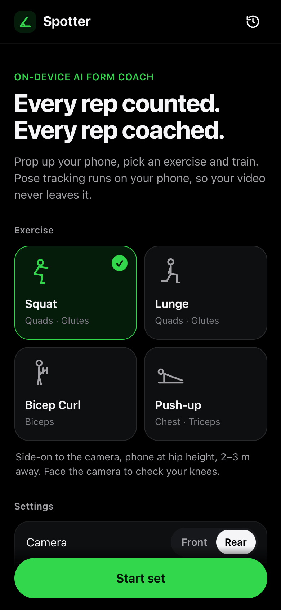
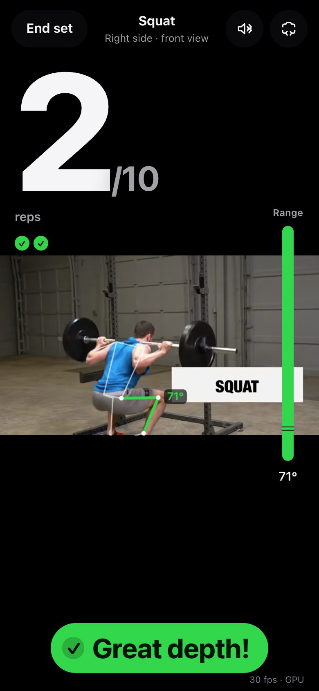
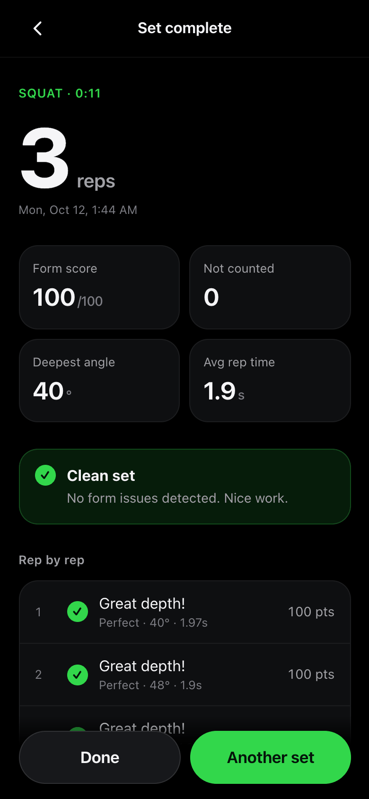
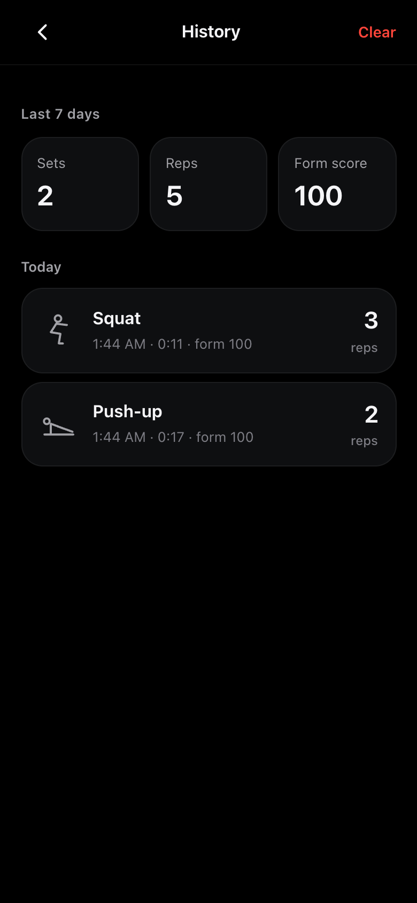
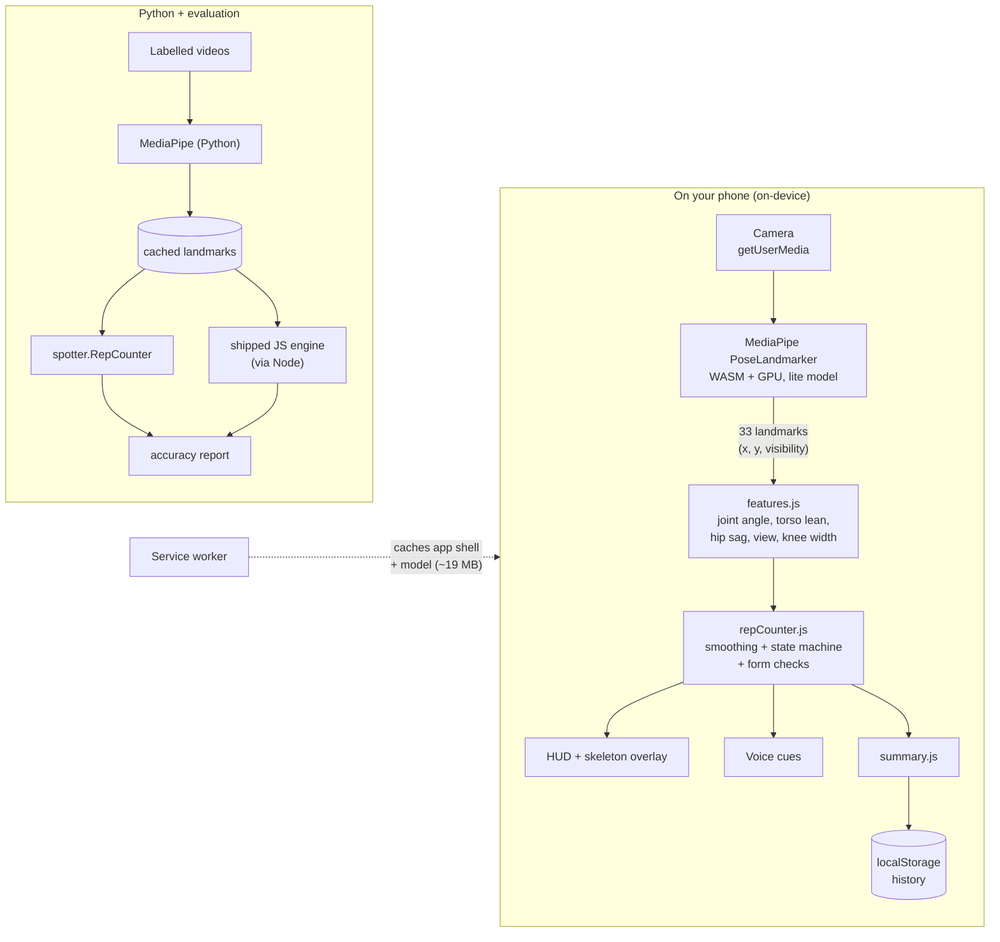
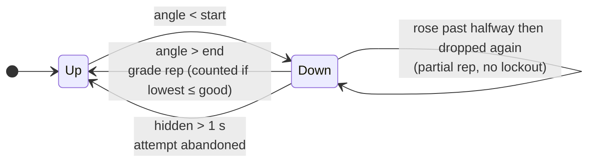

# Spotter: an on-device AI gym form coach

**Prop your phone up, pick an exercise, and train. Spotter counts your reps and coaches your form in real time, with the pose model running in your phone's browser so your video never leaves the device.**

<!-- Badges: replace <your-username> after pushing to GitHub -->
[](https://github.com/<your-username>/fitness-trainer/actions/workflows/ci.yml)
**Live demo:** `https://<your-username>.github.io/fitness-trainer/` (open on your phone, then *Add to Home Screen*)

<!-- DEMO GIF PLACEHOLDER: record a 10–15 s screen capture of a real set on your phone
     (e.g. iOS screen recording -> convert with `ffmpeg -i in.mov -vf "fps=12,scale=360:-1" demo.gif`)
     and save it as docs/demo.gif, then uncomment the next line. -->
<!--  -->

| Home | Live coaching | Set summary | History |
|:---:|:---:|:---:|:---:|
|  |  |  |  |

<sub>Screenshots from real runs in Chrome, with a sample clip fed in as the camera. Workout frame: video by FitnessScape, CC BY 3.0, via Wikimedia Commons.</sub>

---

## Why this project is interesting

- **Real-time computer vision in the browser.** Google MediaPipe's PoseLandmarker (WebAssembly + GPU) finds 33 body landmarks per frame, at 30 fps (the camera's own rate) in desktop Chrome. No server, no API keys, no upload.
- **Signal processing, not just thresholds.** It uses time-based smoothing (frame-rate independent), hysteresis so wobble can't double count, sticky visible-side selection, aspect-ratio-corrected angles, and a glitch filter.
- **A small, testable engine.** Exercises and form rules are *data*. One generic state machine counts reps for squat, lunge, bicep curl and push-up, and grades each rep by its **lowest** angle.
- **Measured, not just demoed.** An evaluation harness scores rep-count accuracy on labelled videos. It caught a real calibration bug: push-ups went from 4/6 to 6/6 counted.
- **Two implementations kept honest.** The same logic exists in JavaScript (shipped) and Python (reference). Parity tests replay identical landmarks through both and require identical reps, grades, scores and cues.
- **A real installable app.** It's a PWA with a service worker and works offline after the first visit (verified by reloading with the network disabled).

## Features

| | |
|---|---|
| **Exercises** | Squat, lunge, bicep curl, push-up |
| **Rep counting** | Hysteresis state machine, graded by the lowest angle reached; partial reps and missed lockouts are flagged but not counted |
| **Form checks** | Squat depth, forward lean, knee cave (front view); lunge torso upright; curl elbow drift and body swing; push-up hip sag and pike |
| **Live feedback** | Skeleton overlay with the measured joint angle, a range meter, a live form cue, and a colour + icon + label banner after every rep |
| **Readable at 2 m** | Giant rep counter, coloured edge flash on each rep, optional voice cues (Web Speech API) |
| **Set summary** | Reps, not-counted reps, form score /100, deepest angle, average rep time, the most common issue to focus on next, and a rep-by-rep list |
| **History** | Saved on the device (localStorage) and grouped by day, with 7-day stats |
| **Phone-friendly** | Front/rear camera switch, countdown, target reps, screen wake lock, landscape layout, back-gesture handling |
| **PWA** | Installable to the home screen and works offline after the first load |

## How it works



**One rep, step by step.** Each frame, the main joint angle (for example the knee for squats) is measured on the side of the body the camera sees best, then smoothed. A rep **starts** when the angle drops below a `start` threshold and **ends** when it rises above a higher `end` threshold. While the rep is in progress, the counter remembers the lowest angle and the min/max of each posture metric. When the rep ends it is graded once:



Squat thresholds, for example, are `start 140°`, `end 160°`, `good 100°` and `perfect 90°`. Each form rule is one line of data:

```js
{ metric: 'torsoLean', agg: 'max', op: '>', limit: 55, cue: 'Keep your chest up' }
```

Want the full explanation? **[LEARNING.md](LEARNING.md)** walks through every design decision from first principles.

## Tech stack

| Layer | Choice | Why |
|---|---|---|
| Pose model | MediaPipe Tasks Vision `PoseLandmarker` 1.1.0, lite model | Fast enough for phones, accurate enough for joint angles, runs fully in the browser |
| App | Plain HTML, CSS and ES modules | No build step: `web/` deploys to GitHub Pages as-is |
| Offline | Service worker + Web App Manifest | Installable, instant start, works in a basement gym with no signal |
| Tests | `node:test` (zero dependencies) + `pytest` | Synthetic stick-figure landmarks drive the real logic |
| Reference | Python 3.11 package `spotter` (stdlib only) + OpenCV desktop coach | Fast iteration and evaluation on recorded videos |
| CI/CD | GitHub Actions | Tests on every push; publishes `web/` to Pages from `main` |

## Getting started

### Run the web app locally

```bash
npm run serve            # same as: python3 -m http.server 8000 --directory web
# open http://localhost:8000 in Chrome, Edge or Safari and allow the camera
```

There's no install step: the app is static files. Browsers only allow camera access on **HTTPS or `localhost`**, so to try it on your phone either:

1. **Deploy to GitHub Pages** (below). This is the easiest option and gives you HTTPS.
2. **Android + USB:** open `chrome://inspect` on your computer, enable *Port forwarding* `8000 → localhost:8000`, then visit `http://localhost:8000` on the phone.
3. **Temporary tunnel** such as `cloudflared tunnel --url http://localhost:8000`. This exposes your dev server publicly while it runs.

### Run the tests

```bash
npm test                                    # 44 JS tests, Node 20+ (no npm install needed)

python3 -m venv venv && source venv/bin/activate
pip install -r python/requirements-dev.txt  # just pytest
pytest                                      # 34 Python tests, including JS<->Python parity
```

### Python desktop coach (optional)

```bash
pip install -r python/requirements.txt      # mediapipe + opencv-python
python python/live_coach.py --exercise squat            # webcam
python python/live_coach.py --exercise pushup --video clip.mp4
```

The pose model (`pose_landmarker_lite.task`, ~6 MB) downloads to `python/models/` on first run.

## Deploy to GitHub Pages

1. Push this repo to GitHub.
2. In **Settings → Pages**, set **Source: GitHub Actions**.
3. Push to `main`. [`.github/workflows/pages.yml`](.github/workflows/pages.yml) runs the JS tests, copies `web/` (without its tests) and publishes it to `https://<your-username>.github.io/<repo>/`.

Every path in the app is relative (`./sw.js`, `start_url: "./"`), so it works under the `/<repo>/` sub-path without configuration. A guard test enforces this.

## Evaluation

**Question:** does the rep counter agree with a human counting the same video?

**Method.** [`eval/evaluate.py`](eval/evaluate.py) runs MediaPipe once per labelled video and caches the landmarks. It then replays them through the **Python** engine, the **shipped JavaScript** engine (`--engine both`), or both, and compares the result with the human count in [`eval/labels.csv`](eval/labels.csv). Caching makes re-tuning thresholds a sub-second loop.

| Metric | Meaning |
|---|---|
| Exact match | % of videos where predicted reps = true reps |
| Within ±1 | % of videos off by at most one rep |
| MAE | mean absolute error in reps per video |
| Bias | mean (predicted − true): positive means over-counting |
| Count accuracy | 1 − Σ\|predicted − true\| / Σ true |

```bash
python eval/download_samples.py      # 2 openly licensed clips from Wikimedia Commons
python eval/evaluate.py --engine both
```

### Results

Current results on the two sample clips ([eval/results.md](eval/results.md), lite model):

| Video | Exercise | View | True | Python | JS (shipped) |
|---|---|---|---|---|---|
| squat_demo.webm | squat | rear 3/4 | 2 | 2 | 2 |
| pushups_side.webm | push-up | side | 6 | 6 | 6 |
| **Total** | | | **8** | **8** | **8** |

> **Read this honestly.** Two clips is a smoke test, not a benchmark. The push-up clip was also used to *calibrate* the lockout threshold: real locked-out arms read only ~150–155° in 2D, so the original 155° threshold counted 4/6. That makes it a development set, not held-out data. A meaningful number needs your own recordings across views, people and lighting.

<!-- RESULTS PLACEHOLDER: after recording your own sets (see eval/labels.csv for the format),
     run `python eval/evaluate.py --engine both` and paste the summary table here. -->
| Your dataset | Videos | Exact match | Within ±1 | MAE | Count accuracy |
|---|---|---|---|---|---|
| _your recordings_ | _n_ | _–_ | _–_ | _–_ | _–_ |

## Project structure

```
web/                    the PWA (deployed as-is)
  index.html            all four screens + SVG icon sprite
  css/styles.css        dark, mobile-first design tokens and layout
  js/core/              pure logic, no DOM; mirrored in python/spotter
    geometry.js         angles, tilt, time-based EMA smoothing
    features.js         landmarks -> angle, lean, hip sag, view, knee width
    exercises.js        exercise configs: thresholds, cues, form checks
    repCounter.js       the state machine and rep grading
    summary.js          per-set statistics
  js/app.js             screens, workout loop, wiring
  js/pose.js            MediaPipe loader (GPU with CPU fallback)
  js/camera.js, overlay.js, hud.js, views.js, voice.js, storage.js, pwa.js
  sw.js                 service worker (offline caching)
  manifest.webmanifest  install metadata
  tests/                node:test suites + synthetic "puppet" landmarks
python/
  spotter/              Python reference implementation (stdlib only)
  live_coach.py         OpenCV desktop coach
  tests/                pytest suites, including JS<->Python parity
  legacy/               the original prototypes this project grew from
eval/
  evaluate.py           rep-count accuracy on labelled videos
  labels.csv            ground truth
  run_js_counter.mjs    runs the shipped JS engine on cached landmarks
  download_samples.py   fetches the openly licensed sample clips
.github/workflows/      CI (tests) and GitHub Pages deployment
```

## Privacy

Camera frames are processed in the browser and never uploaded; there is no backend. Workout history stays in your browser's localStorage. One caveat, shown in the app as well: per its privacy notice, the MediaPipe Tasks library sends anonymous performance and usage metrics to Google.

## Limitations and roadmap

- **2D angles depend on camera placement.** Side-on views work best; front views can't see knee flexion well, and knee-cave checks need a front view. *Next:* use MediaPipe's 3D world landmarks to reduce view dependence.
- **Thresholds are hand-tuned.** They're calibrated on very little real data. *Next:* collect a labelled dataset and fit thresholds per exercise and view.
- **One person in frame.** People walking behind you can confuse tracking.
- **Untested on many phones.** Performance and Safari/iOS quirks need checking on real devices.
- *Ideas:* shoulder press and deadlift (extension-direction exercises), rest timer, export history to CSV, a per-user calibration rep.

## Credits

- [MediaPipe](https://ai.google.dev/edge/mediapipe) by Google (Apache 2.0): pose model and runtime.
- Evaluation sample clips (downloaded on demand, not redistributed): *Squat – exercise demonstration video* by FitnessScape (CC BY 3.0); *Interval Push-ups* by Taco fleur (CC BY-SA 4.0); both via Wikimedia Commons.
- Visual style inspired by [openGym](https://opengym.ch).
